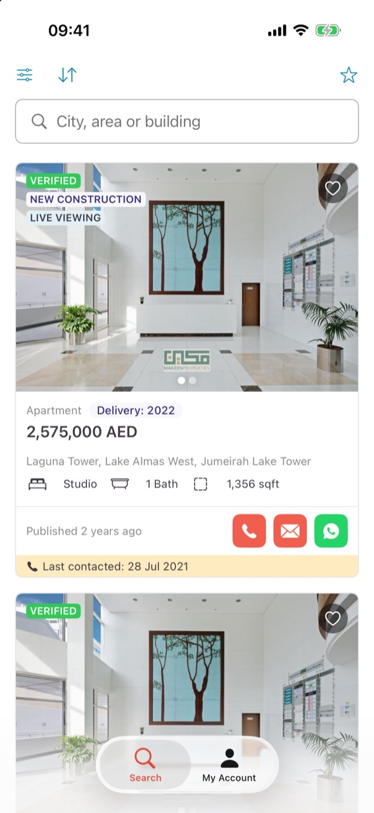
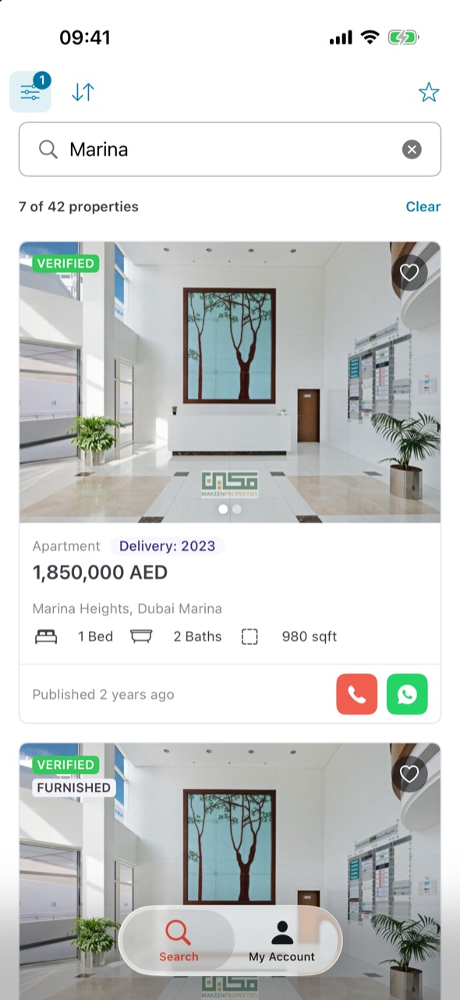
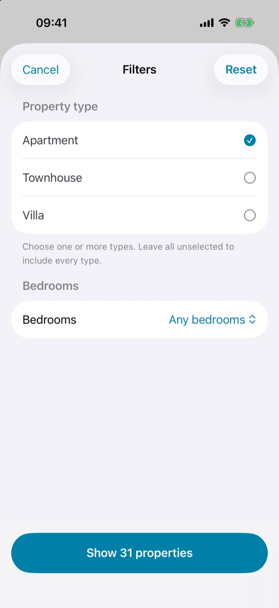
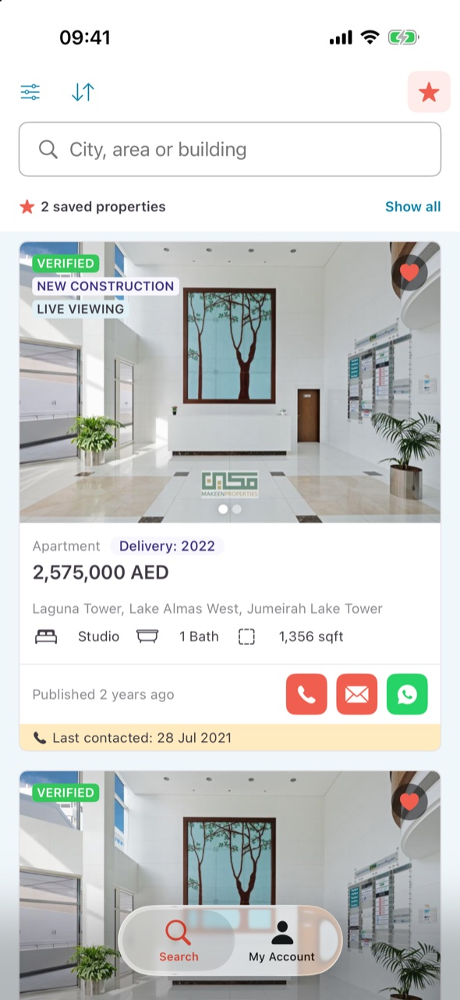
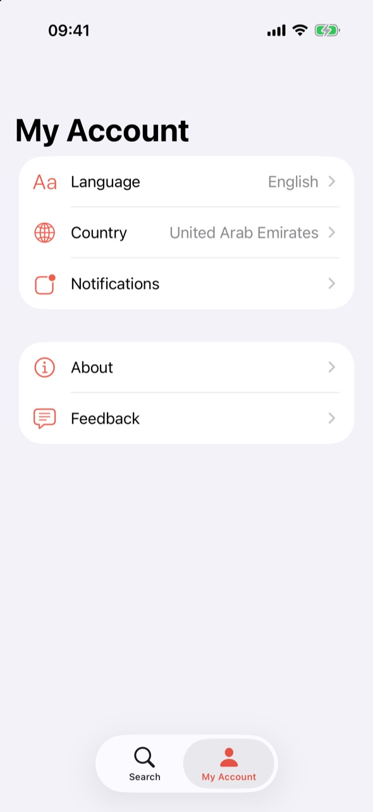
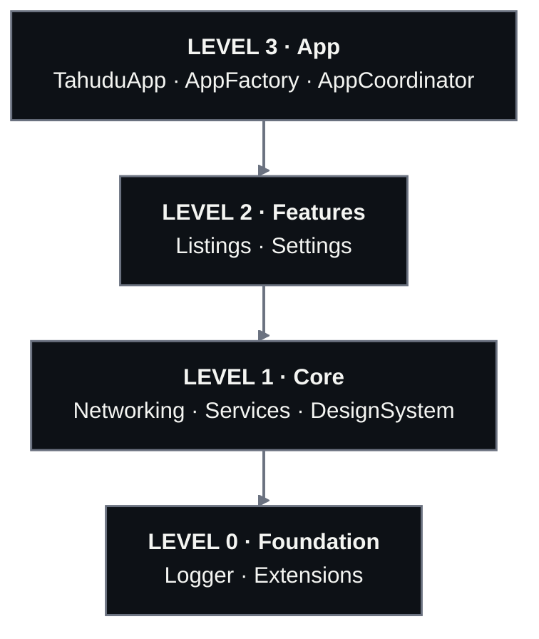
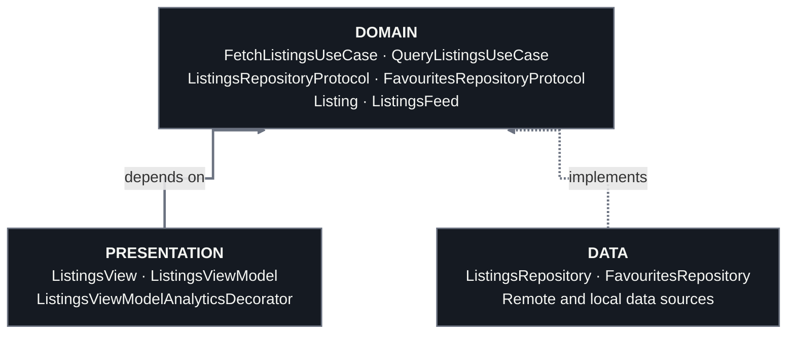

# Tahudu — Property Finder iOS Take-Home

An iOS property browser for the supplied exercise: browse live listings, search, filter and sort them, save favourites, and keep browsing offline. Search is SwiftUI.

**iOS 26+ · Swift 6 · SwiftUI + Observation · UIKit · Local Swift package · No third-party app libraries**

https://github.com/user-attachments/assets/7ef786ff-7206-4a9e-a359-277718a969b7

The original brief, JSON contract and reference design are in [TASK.md](TASK.md).

[Run the app](#run-the-app) · [Features](#features) · [Architecture](#architecture) · [Decisions](#decisions) · [Testing](#testing) · [Tooling and CI](#tooling-and-ci) · [Next steps](#next-steps)

## Run the app

1. Open **[Tahudu.xcodeproj](Tahudu.xcodeproj)** in Xcode 26 or newer.
2. Select the **Tahudu** scheme and an iPhone or iPad simulator running iOS 26 or newer.
3. Press **⌘R**.

The generated project is included, so no tools, setup scripts or API keys are needed. The first load needs internet access; after that, a saved copy covers connection failures.

## Features

| Exercise | Implementation |
| --- | --- |
| **Task 1 — Search UI** | SwiftUI cards with a photo carousel, badges, property details, relative dates, a last-contacted banner and contact buttons, under a pinned search header. Fonts and spacing follow the brief. |
| **Task 2 — Live listings** | `URLSession` with `async/await`, DTO decoding and mapping to domain models. |
| **Task 3 — Favourites** | Hearts toggle favourites, saved on the device. The header star shows favourites only, with a filled star, a summary, a “Show all” action and tinted results. |
| **Bonus — Settings** | A separate UIKit feature with a row-driven table and reusable cells. The supplied placeholder actions are unchanged. |

Beyond the brief:

- **Search, filters and sorting:** text search over location and type (ignoring case), property type and bedroom filters with a live result count, and sorting by newest or price. They all combine with favourites.
- **Loading and errors:** skeleton cards while loading, pull to refresh, distinct empty states, and inline messages that keep existing results.
- **Offline browsing:** the last response and its ETag are saved. Unchanged feeds come back as 304, a saved copy is shown with an offline notice when the connection fails, and the list refreshes when the connection returns.
- **Analytics and feature flags:** favourite and contact taps are tracked through a decorator, without listing IDs. Filters and sorting sit behind flags from a local placeholder provider.
- **Accessibility:** icon-only buttons have VoiceOver labels, toggles report their selected state, and key elements have identifiers for UI tests.
- **Polish:** a native launch screen, private log details, and a privacy manifest for UserDefaults.

Contact buttons and Settings rows only log their action, as the brief asks.

### Screenshots

| Results | Search | Filters | Favourites | My Account |
| :---: | :---: | :---: | :---: | :---: |
|  |  |  |  |  |

## Architecture

Seven library targets in one local Swift package (`PropertyFinderKit`), arranged in four levels. **Every arrow points down**, and the two features never import each other.



- **Only the app knows every module.** `AppFactory` creates the shared services and passes them to each feature's factory through initializers; `AppCoordinator` owns the tabs.
- **Features are independent.** Listings and Settings can be built and tested alone. Settings, the refactored UIKit screen, needs nothing below it.
- **Core modules don't know each other.** Networking (HTTP client and connectivity), Services (analytics and feature flags) and DesignSystem (colours, type, spacing and shared components) only reach down to Logger and Extensions.

### Inside a feature

Listings uses folders rather than modules for its layers, but the rule is the same: **Presentation and Data both point at Domain, and Domain points at nothing.**

```text
Packages/PropertyFinderKit/Sources/Features/Listings/
├── ListingsFactory.swift
├── Domain/         Models, repository protocols and use cases
├── Data/           Endpoint, DTOs, data sources and repositories
└── Presentation/   Views, view model, analytics decorator and display models
```



A solid arrow is a compile-time dependency: Presentation calls use-case protocols. A dashed arrow is an implementation: Data implements the repository protocols that Domain declares, so Domain never knows Data exists. Every seam is a protocol, from the view's `ListingsViewModelProtocol` down to the data sources, so each layer can take a stub in tests and previews. `ListingsFactory` is the only place that picks the real implementations.

## Decisions

### Shaped by the role

The job description asks for iOS 26, Observation, a modular app and Swift concurrency, so the exercise uses each of them on purpose rather than taking the simplest path:

- **iOS 26 minimum:** the current SDK and system design, with no availability checks or fallbacks.
- **Observation:** `@Observable` view models read directly by SwiftUI, with no Combine or `ObservableObject`.
- **A modular app:** seven Swift package targets in four levels. That's more structure than a two-screen exercise needs, but it shows how features stay apart as an app grows.
- **Swift 6 concurrency:** Swift 6 language mode with full checking, `async/await` with cancellation, UI state on the main actor, `Sendable` services and an `AsyncStream` for connectivity changes.

### Tradeoffs

| Decision | Why, and the tradeoff |
| --- | --- |
| **Feature targets, layered inside** | Features stay independent and shared code reusable. The layers inside a feature are folder conventions, not compiler-enforced. |
| **MVVM with protocols** | Views stay simple, and every layer can be replaced by a stub in tests and previews. |
| **Manual factories** | Dependencies are visible without a DI library; the wiring grows with them. |
| **Explicit screen states** | Empty feed, no favourites, no matches and failure each get their own message. Refresh and offline notices never replace results. |
| **Conditional requests and a saved copy** | 304 reuses the saved body. Only connection failures and timeouts fall back to it; server errors and malformed data stay errors. The OS may clear the cache. |
| **Local querying** | Search, filters and sorting run on the full feed without extra requests. Price sorting groups currencies rather than converting them. |
| **Analytics and flags behind protocols** | A decorator keeps tracking out of the view model, and real providers can replace the logging and local ones later. |

## Testing

XCTest targets in the package: `NetworkingTests`, `ListingsTests`, `SettingsTests` and `SnapshotTests`, run from `TestPlans/Tahudu.xctestplan`.

- **Unit tests** cover request building, ETag and 304 handling, the offline fallback, search, filters and sorting, favourites, card formatting, the view model's states and reconnect refresh, analytics, feature flags and the Settings rows.
- **No real API:** every dependency is a protocol replaced by a small stub, the HTTP client test answers in-process through a `URLProtocol` stub, and the app is never launched.
- **Snapshots** compare two listing cards, the full Listings screen and the Settings list against PNGs in `Tests/SnapshotTests/__Snapshots__/`, using a small in-house helper. They're recorded on iOS 26.2 (English (US) only, US region) and skipped on other versions. To accept a visual change, delete the PNG and run the test twice.
- **Conventions:** each test marks `// Given`, `// When` and `// Then`, and is named `test_unit_condition_result`.

Run them with ⌘U, or `bundle exec fastlane ios test` from `Tooling/`.

UI tests aren't written yet, but the Listings screen is ready for them: identifiers follow `listings.<element>` (for example `listings.search`) and `listing.<id>.<element>` (for example `listing.<id>.favourite`).

## Tooling and CI

Reviewers need only Xcode. Everything below is for contributors, and every tool is pinned to an exact version, so a run on a laptop and a run in CI behave the same. Setup and commands are in [Tooling/README.md](Tooling/README.md).

| Tool | What it does here | Why it's here |
| --- | --- | --- |
| **mise** | Pins Ruby, Tuist, SwiftFormat and Gitleaks in `.mise.toml`. | One file and one `mise install` replace separate Homebrew, rbenv and manual installs. CI installs the same versions through the mise action, which ends "works on my machine". |
| **Bundler** | Locks Fastlane and its Ruby gems in `Tooling/Gemfile.lock`. | Fastlane only changes when the lock file does, and CI rejects an outdated lock. |
| **Tuist** | Generates `Tahudu.xcodeproj` from `Project.swift`. | The project is reviewed as Swift code instead of `.pbxproj` diffs. The generated project is committed, so reviewers don't need Tuist. (It should be gitignored in a production app) |
| **Fastlane** | `test`, `build` and `ci` (tests, then a Release build). | One command runs the same steps locally and in CI, so the workflow file stays a thin wrapper and CI failures can be reproduced on a laptop. Signing and TestFlight lanes can be added later without touching the workflow. |
| **SwiftFormat** | Checks formatting against `Tooling/.swiftformat`. | Style is settled by a tool instead of in code review. The hook and CI read the same config, so they never disagree. |
| **Gitleaks** | Scans for API keys, tokens and other secrets. | A secret that reaches Git history is hard to remove, so it's caught before the commit and again across the whole history in CI. |
| **Pre-commit hook** | Runs SwiftFormat and Gitleaks on the staged changes. | Mistakes show up in seconds instead of after a push. It checks exactly what will be committed and never edits files. It's opt-in, and lets a commit through with a notice if a tool is missing, because CI enforces the same checks. (Shift Left) |
| **GitHub Actions** | Runs the pipeline on pull requests and pushes to `main`. | The project is shared on GitHub, as the brief asks, and hosted macOS 26 runners provide Xcode 26.3. Actions are pinned to commits, permissions are read-only and no secrets are needed. |

The CI pipeline, in order:

1. Install the pinned tools.
2. Check formatting and scan the full Git history for secrets.
3. Regenerate the project and fail if anything changed.
4. Run `fastlane ios ci`: the unit and snapshot tests, then a Release build.

There's no signing or deployment yet.

Later, as the app grows:

- **Tuist cache:** reuse built modules so local and CI builds skip unchanged targets. It needs the modules defined as Tuist targets, or a Tuist account for its Xcode compilation cache.
- **CI caching:** keep DerivedData and installed tools between runs.
- **Delivery:** Fastlane lanes for signing with `match` and TestFlight uploads.